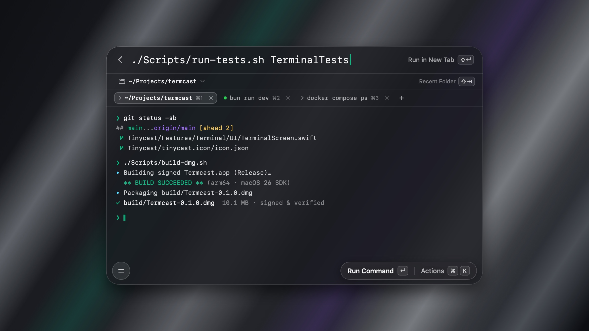

<h1 align="center">
   
  Termcast
</h1>

  A fork of <a href="https://github.com/abue-ammar/tinycast">Tinycast</a> adding an integrated <strong>Terminal Mode</strong> directly inside the launcher palette.

  <a href="https://github.com/mj0lken/TermCast/releases"><strong>Releases</strong></a> ·
  <a href="#install"><strong>Install</strong></a> ·
  <a href="docs/features/terminal.md"><strong>Terminal Docs</strong></a> ·
  <a href="https://tinycast.dev/docs/"><strong>Launcher Docs</strong></a>

  <a href="https://github.com/mj0lken/TermCast/releases/latest"><picture><source media="(prefers-color-scheme: dark)" srcset="https://shieldcn.dev/github/release/mj0lken/TermCast.svg?variant=ghost&amp;font=geist-mono&amp;mode=dark&amp;label=RELEASE&amp;logo=lu:Tag&amp;valueColor=60A5FA" /></picture></a>
  <a href="https://github.com/mj0lken/TermCast/releases"><picture><source media="(prefers-color-scheme: dark)" srcset="https://shieldcn.dev/github/downloads/mj0lken/TermCast.svg?variant=ghost&amp;font=geist-mono&amp;mode=dark&amp;label=DOWNLOADS&amp;logo=lu:CloudDownload&amp;valueColor=A78BFA" /></picture></a>
  <a href="https://github.com/mj0lken/TermCast/actions/workflows/release.yml"><picture><source media="(prefers-color-scheme: dark)" srcset="https://shieldcn.dev/github/ci/mj0lken/TermCast.svg?variant=ghost&amp;font=geist-mono&amp;mode=dark&amp;workflow=release.yml&amp;label=BUILD&amp;logo=lu:Hammer&amp;valueColor=4ADE80" /></picture></a>
   
  <picture><source media="(prefers-color-scheme: dark)" srcset="https://shieldcn.dev/badge/MACOS-26%2B.svg?variant=ghost&amp;font=geist-mono&amp;mode=dark&amp;logo=apple" /></picture>
  <picture><source media="(prefers-color-scheme: dark)" srcset="https://shieldcn.dev/badge/SWIFT-6.svg?variant=ghost&amp;font=geist-mono&amp;mode=dark&amp;logo=swift&amp;valueColor=FB923C" /></picture>
  <a href="LICENSE"><picture><source media="(prefers-color-scheme: dark)" srcset="https://shieldcn.dev/badge/LICENSE-AGPL--3.0.svg?variant=ghost&amp;font=geist-mono&amp;mode=dark&amp;logo=lu:Scale" /></picture></a>

  

Built with SwiftUI and AppKit. No dependencies, no Electron, no telemetry. It runs your Raycast
extensions, too.

## Terminal Mode

Enable **Terminal** in **Settings → Terminal** to run shell commands and live PTY sessions inside the palette without opening a separate Terminal window:

- **Command detection & formatting:** Writing a shell command in the launcher formats the input in monospace, displays the active working directory directly underneath the input bar, and highlights `Terminal ⇧↵`.
- **`Shift+Enter` (`⇧↵`):** Runs the typed command in a terminal panel tab (or opens the Terminal panel when the input is empty).
- **`>` quick entry:** Typing `>` (or `> `) jumps straight into the Terminal panel and its open tabs.
- **`Shift+Tab` (`⇧⇥`):** Cycles through recent folders right under the input bar before running a command.
- **Multi-tab PTY sessions:** Create (`⌘N`), switch (`⌘1`–`⌘9` or `⇥`), send stdin, stop (`⌘.`), and close (`⌃X`) tabs with full ANSI color streaming and persistent `cd` directory tracking. See [docs/features/terminal.md](docs/features/terminal.md).

[Explore all inherited launcher features →](https://tinycast.dev/#features)

## Install

Requires macOS 26 or newer:

- **DMG:** Download the latest `Termcast-<version>.dmg` (or `Termcast-Universal-<version>.dmg` on Intel) from [Releases](https://github.com/mj0lken/TermCast/releases) and drag `Termcast.app` to `/Applications`.
- **Build from source:** Run `./Scripts/build-dmg.sh` to build a signed `build/Termcast-<version>.dmg` locally (see [docs/development.md](docs/development.md)).

## Upstream & Support

Termcast builds on [Tinycast](https://github.com/abue-ammar/tinycast) by Abue Ammar. If you'd like to support upstream Tinycast development:

  <a href="https://tinycast.dev/support"><picture><source media="(prefers-color-scheme: dark)" srcset="https://shieldcn.dev/badge/SUPPORT-CARD.svg?variant=outline&amp;size=lg&amp;font=geist-mono&amp;mode=dark&amp;logo=lu:CircleDollarSign&amp;logoColor=A78BFA&amp;valueColor=A78BFA" /></picture></a>
  <a href="https://tinycast.dev/support?method=crypto"><picture><source media="(prefers-color-scheme: dark)" srcset="https://shieldcn.dev/badge/SUPPORT-CRYPTO.svg?variant=outline&amp;size=lg&amp;font=geist-mono&amp;mode=dark&amp;logo=lu:Bitcoin&amp;logoColor=FBBF24&amp;valueColor=FBBF24" /></picture></a>

## License

Termcast is licensed under the [AGPL-3.0 license](LICENSE).
