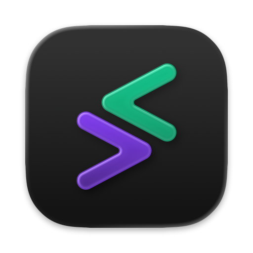
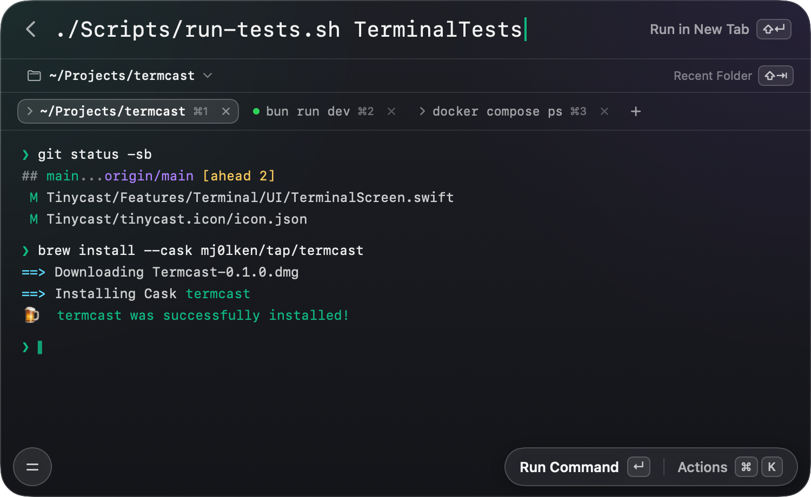

<h1 align="center">
  <a href="https://mj0lken.github.io/TermCast/"></a><br>
  TermCast — a Tinycast fork
</h1>

<p align="center">
  A native macOS launcher built on <a href="https://github.com/abue-ammar/tinycast">Tinycast</a> with an <strong>integrated multi-tab PTY terminal</strong>, <strong>Hyper Key trackpad sliders</strong> for per-display brightness &amp; volume, and <strong>Magnet-grade window management</strong>—all inside one lightweight SwiftUI + AppKit palette.
</p>

<p align="center">
  <a href="https://mj0lken.github.io/TermCast/"><strong>Website</strong></a> ·
  <a href="https://github.com/mj0lken/TermCast/releases"><strong>Releases</strong></a> ·
  <a href="#install"><strong>Install</strong></a> ·
  <a href="#1-native-multi-tab-pty-terminal"><strong>Terminal</strong></a> ·
  <a href="#2-hyper-key--trackpad-scroll-sliders"><strong>Hyper Key</strong></a> ·
  <a href="#3-window-management"><strong>Window Management</strong></a>
</p>

<p align="center">
  <a href="https://github.com/mj0lken/TermCast/releases/latest"><picture><source media="(prefers-color-scheme: dark)" srcset="https://shieldcn.dev/github/release/mj0lken/TermCast.svg?variant=ghost&amp;font=geist-mono&amp;mode=dark&amp;label=RELEASE&amp;logo=lu:Tag&amp;valueColor=10B981" /></picture></a>
  <a href="https://github.com/mj0lken/TermCast/releases"><picture><source media="(prefers-color-scheme: dark)" srcset="https://shieldcn.dev/github/downloads/mj0lken/TermCast.svg?variant=ghost&amp;font=geist-mono&amp;mode=dark&amp;label=DOWNLOADS&amp;logo=lu:CloudDownload&amp;valueColor=A78BFA" /></picture></a>
  <a href="https://github.com/mj0lken/TermCast/actions/workflows/release.yml"><picture><source media="(prefers-color-scheme: dark)" srcset="https://shieldcn.dev/github/ci/mj0lken/TermCast.svg?variant=ghost&amp;font=geist-mono&amp;mode=dark&amp;workflow=release.yml&amp;label=BUILD&amp;logo=lu:Hammer&amp;valueColor=34D399" /></picture></a>
  <br>
  <picture><source media="(prefers-color-scheme: dark)" srcset="https://shieldcn.dev/badge/MACOS-26%2B.svg?variant=ghost&amp;font=geist-mono&amp;mode=dark&amp;logo=apple" /></picture>
  <picture><source media="(prefers-color-scheme: dark)" srcset="https://shieldcn.dev/badge/SWIFT-6.svg?variant=ghost&amp;font=geist-mono&amp;mode=dark&amp;logo=swift&amp;valueColor=FB923C" /></picture>
  <a href="LICENSE"><picture><source media="(prefers-color-scheme: dark)" srcset="https://shieldcn.dev/badge/LICENSE-AGPL--3.0.svg?variant=ghost&amp;font=geist-mono&amp;mode=dark&amp;logo=lu:Scale" /></picture></a>
</p>

<p align="center">
  
</p>

Built natively with SwiftUI and AppKit—zero third-party dependencies, no Electron, no telemetry, and a `<100 MB` memory footprint. Runs Raycast store extensions natively in JavaScriptCore.

## Install

Requires **macOS 26** or newer:

```bash
brew install --cask mj0lken/tap/termcast
```

Or download the signed `Termcast-<version>.dmg` (or `Termcast-Universal-<version>.dmg` for Intel) directly from [**Releases**](https://github.com/mj0lken/TermCast/releases) and drag `Termcast.app` into `/Applications`.

---

## Core Superpowers

### 1. Native Multi-Tab PTY Terminal

Run real shell commands and interactive CLI tools right inside the launcher palette—backed by true `PseudoTerminal` sessions, packed 16-byte cell buffers with VM-slab scrollback, ANSI color themes, and persistent `cd` working-directory tracking.

| Trigger | Action |
| :--- | :--- |
| **Type any CLI command** | Switches the search bar to monospace, reveals the working-directory strip, and arms `Terminal ⇧↵` |
| **`⇧↵` (`Shift+Return`)** | Runs the typed command in a live PTY tab (or opens Terminal Mode when empty) |
| **`>`** | Jumps directly into Terminal Mode and active sessions |
| **`⇧⇥` (`Shift+Tab`)** | Cycles through recent working folders right under the search bar |
| **`⌘N` / `⌘1`–`⌘9` / `⇥`** | Spawns and switches between concurrent PTY tabs |
| **`⌘.` / `⌃X`** | Sends `SIGINT` to a running process or closes an idle tab |

Architecture details: [`docs/features/terminal.md`](docs/features/terminal.md).

### 2. Hyper Key & Trackpad Scroll Sliders

Turn `Caps Lock` (or another modifier) into a system-wide **Hyper Key** (`⌃⌥⌘⇧`) with optional Quick Press (`Esc`, Caps Lock toggle, or input-source switch), Secure Input fallback, and **three-zone trackpad scroll sliders**:

| Hold Hyper + Two-Finger Vertical Scroll | Controls | Details |
| :--- | :--- | :--- |
| **Left third of trackpad** | **Display Brightness** | Targets **only the display under your cursor**—smooth `DisplayServices` + native macOS HUD on Apple displays, and EDID-matched `IOAVService` DDC/CI (`VCP 0x10`) on external monitors |
| **Center third of trackpad** | **Keyboard Backlight** | Fine `1/64` (`⇧⌥`) steps via isolated `.privateState` HID media events |
| **Right third (or external mouse wheel)** | **System Volume** | `1/64` fine steps on local speakers/wired headphones; `45 ms`-paced `1/16` steps over Bluetooth AVRCP for zero lag |

Zones lock on touch-down so sideways finger drift never jumps controls, and post-release trackpad momentum is suppressed automatically. Architecture details: [`docs/features/hotkeys.md`](docs/features/hotkeys.md).

### 3. Window Management

Full mouse-and-keyboard window tiling without installing a separate window manager:

- **Drag-to-Snap & Drag-Away Restore** — Drag any window to screen edges or corners for halves, quarters, horizontal/vertical thirds, or maximize, with customizable edge sensitivity, interactive zone toggles, live Liquid Glass snap previews, `Esc` / right-click cancel, and automatic original-size restore when dragging away.
- **Traffic-Light Hover Menu** — Hover a window's green zoom (or yellow minimize) button to summon a non-activating tiling popover with schematic tile icons and your custom sizes.
- **Fractional Grid & Multi-Display Layouts** — Draw custom tiles on a `6×4`, `12×8`, or `24×12` visual grid, toggle tight screen-edge fitting (`0 pt` outer margins with inner gaps), save multi-monitor **Window Layouts** and **Rooms**, or trigger any tile from the menu-bar **Window Management** submenu and global hotkeys.

Architecture details: [`docs/features/window-management.md`](docs/features/window-management.md).

---

## Inherited Launcher Suite

Built on upstream [Tinycast](https://github.com/abue-ammar/tinycast), including:

- **Fuzzy Launcher & Per-App Hotkeys** — Instant app, file, menu-bar item, and system-action search with learned local ranking.
- **Raycast Extensions & AI** — Native JavaScriptCore runtime for Raycast extensions, plus Quick AI, AI Chat, local CLI providers (Claude, Codex, Antigravity, OpenCode), and MCP tool servers.
- **Clipboard, Snippets, Notes & Calculator** — Searchable text/image clipboard history, keyword text expansion, floating Markdown scratchpad, quicklinks, emoji picker, and live currency/unit/timezone math.
- **Portable `.termcast` Backups & `settings.json`** — Export/import `.termcast`, `.tinycast`, and Raycast `.rayconfig` archives, or sync preferences with `~/.config/termcast/settings.json`.

---

<p align="center">
  <a href="https://mj0lken.github.io/TermCast/">Website</a> ·
  <a href="https://github.com/mj0lken/TermCast">GitHub</a> ·
  <a href="https://github.com/mj0lken/TermCast/releases">Releases</a> ·
  <a href="LICENSE">AGPL-3.0 License</a>
</p>
